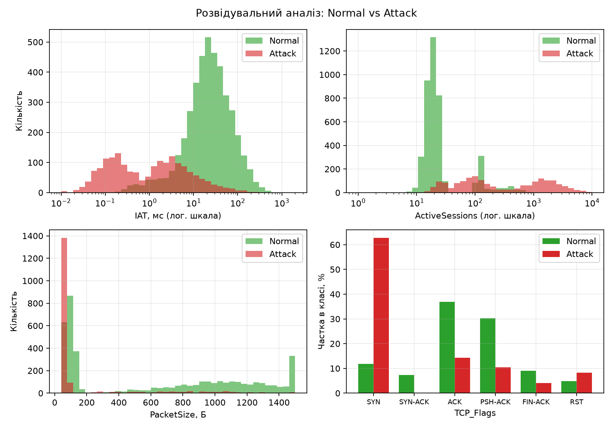
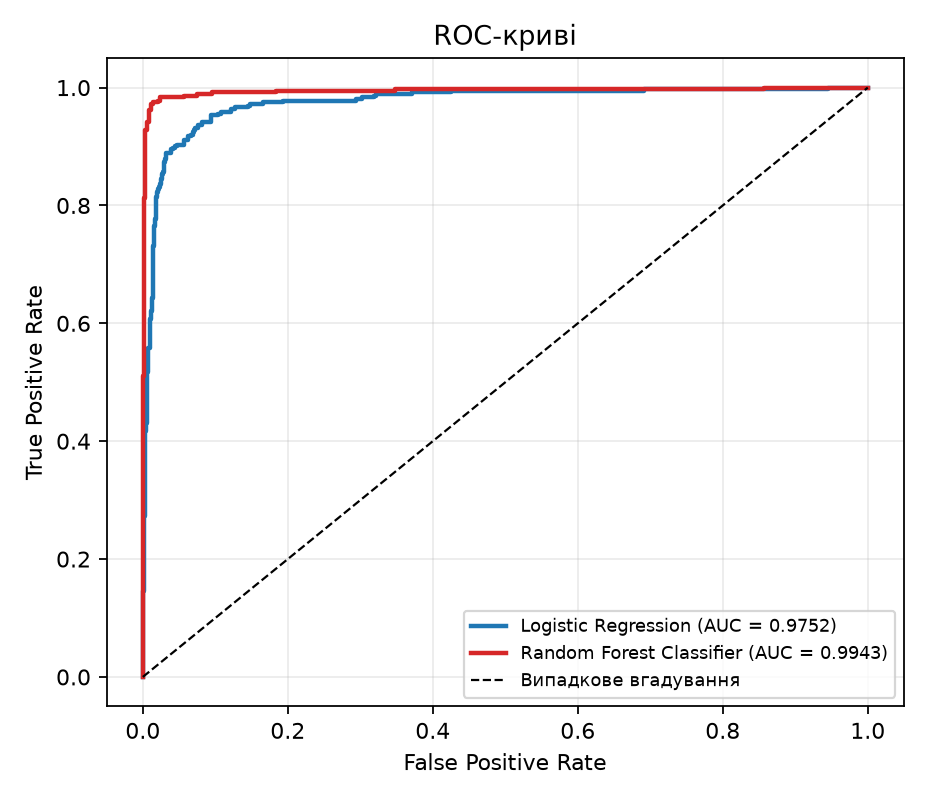
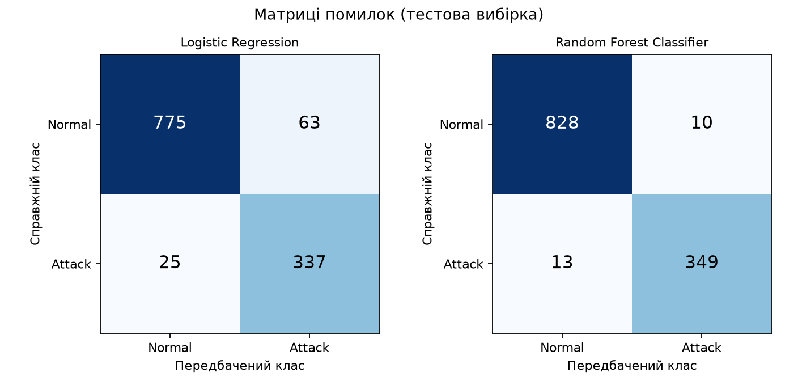
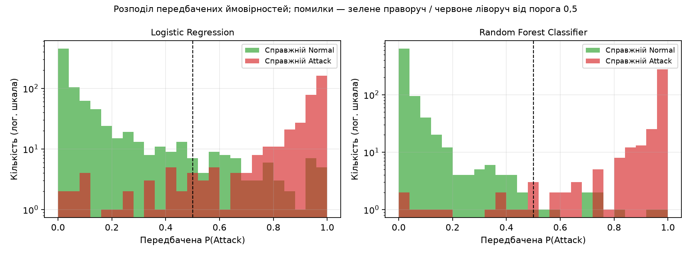
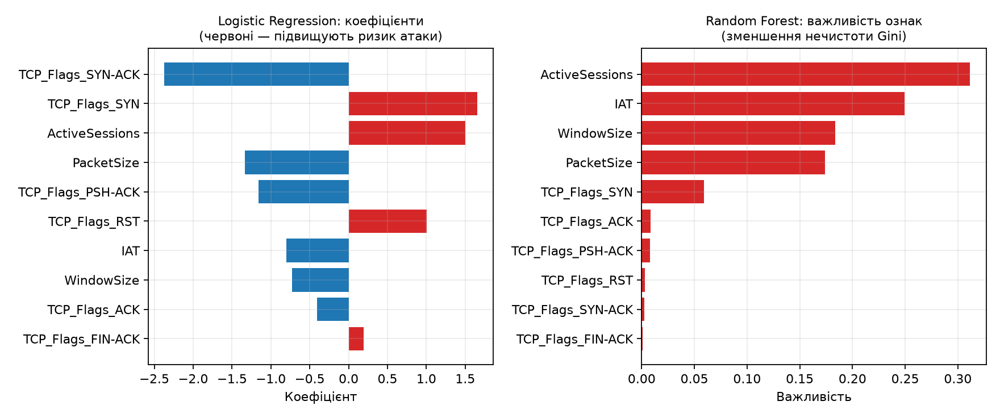

# Лабораторна робота №2
**Тема:** «Класичні алгоритми машинного навчання та регресійний/класифікаційний аналіз інженерних даних на мові Python»
**Варіант 2 (CS):** детекція аномалій та атак у мережевому трафіку (NIDS)
**Виконав:** Атамась Антон Валерійович, група: ______

---

## 1. Мета та постановка задачі

Формалізувати інженерну задачу виявлення шкідливого мережевого трафіку як задачу бінарної класифікації (Supervised Learning), реалізувати конвеєр предобробки, навчити та порівняти два алгоритми.

| Параметр | Значення |
| --- | --- |
| Вхідні ознаки X | `PacketSize`, `IAT`, `TCP_Flags`, `WindowSize`, `ActiveSessions` |
| Цільова змінна Y | 0 — Normal, 1 — Attack (PortScan / DDoS) |
| Алгоритми | Logistic Regression vs Random Forest Classifier |
| Тип задачі | Бінарна класифікація |
| Інженерна мета | Виявляти шкідливий мережевий трафік у реальному часі |

## 2. Дані

Реальний розмічений трафік недоступний, тому використано **синтетичний набір**, згенерований функцією `generate_synthetic_nids` (`src/data_loader.py`, `seed = 42`) і збережений у `data/telemetry_dataset.csv`: **6000 записів, частка атак 30.2%** (приблизно порівну PortScan і DDoS).

| Ознака | Тип | Зміст | Нормальний трафік | PortScan | DDoS |
| --- | --- | --- | --- | --- | --- |
| `PacketSize` | числова, Б | розмір пакета | двомодальний: малі ACK (~90) та великі дані (~1100) | малі SYN-проби (~54) | малі SYN-flood (~60) та великі HTTP-flood |
| `IAT` | числова, мс | інтервал між пакетами | медіана ~25 | ~3 | ~0,15 |
| `TCP_Flags` | категоріальна | прапорці TCP | здебільшого ACK, PSH-ACK | SYN (70%), RST, FIN | SYN (60%), ACK, PSH-ACK |
| `WindowSize` | числова, Б | вікно TCP | типові 8–65 КБ | малі (1024–5840) | підроблені / випадкові |
| `ActiveSessions` | числова | активні сесії джерела | ~18 (інколи до ~120) | ~90 | ~1500 |

Щоб задача не була тривіальною, у генератор свідомо закладено «складні» випадки:
* **5% легітимних сплесків** (CDN, резервне копіювання): короткий IAT, багато сесій, багато SYN — схожі на атаку;
* **10% «стелс-атак»**, які імітують нормальну швидкість та кількість сесій;
* **0,5% хибних міток** (шум розмітки).


*Рис. 1 — Розподіл ознак для Normal та Attack. Атаки відрізняються за IAT і ActiveSessions, але розподіли частково перекриваються.*

## 3. Предобробка (Scaling, Encoding)

Усі кроки зібрано в `ColumnTransformer` усередині `Pipeline`, тому масштабування «вчиться» лише на навчальній вибірці (без витоку даних із тесту):

| Ознаки | Перетворення | Чому |
| --- | --- | --- |
| `IAT`, `ActiveSessions` | `log(1 + x)` → `StandardScaler` | розподіли мають важкі хвости (від 0,01 до 2000 мс; від 1 до 10 000 сесій) |
| `PacketSize`, `WindowSize` | `StandardScaler` | вирівнювання масштабів для логістичної регресії |
| `TCP_Flags` | `OneHotEncoder` | прапорці — номінальна ознака без порядку |

Поділ на train/test — **80 % / 20 %** (4800 / 1200 записів), **стратифікований** (однакова частка атак), `random_state = 42`.

## 4. Моделі

| Модель | Гіперпараметри |
| --- | --- |
| Logistic Regression | `max_iter=1000`, `class_weight="balanced"` |
| Random Forest Classifier | `n_estimators=200`, `max_depth=12`, `min_samples_leaf=2`, `class_weight="balanced"` |

`class_weight="balanced"` використано, бо атак менше, ніж нормального трафіку, а **пропущена атака (FN) для NIDS дорожча за хибну тривогу (FP)**.

## 5. Методика оцінки

* **Якість:** Accuracy, Precision, Recall, F1-Score, ROC-AUC, а також FPR (частка хибних тривог серед нормального трафіку) на тестовій вибірці. Для NIDS ключові Recall (скільки атак виявлено) і Precision/FPR (скільки хибних тривог отримає адміністратор).
* **Стійкість:** стратифікована 5-fold крос-валідація (F1, ROC-AUC) на всьому наборі.
* **Ресурси:** час навчання (медіана з 3 запусків), затримка передбачення (мкс на запис, мінімум із 20 повторів), піковий обсяг пам'яті під час навчання (`tracemalloc`). Час і пам'ять вимірюються окремими запусками, бо `tracemalloc` уповільнює код. `tracemalloc` бачить лише виділення пам'яті на рівні Python/NumPy, тому значення — оцінка, а не точний обсяг процесу.

## 6. Результати

Середовище виконання: Python 3.14.7, `macOS-26.6.2-arm64-arm-64bit-Mach-O`.

**Таблиця 1 — Якість класифікації (тестова вибірка, 1200 записів)**

| Алгоритм | Accuracy | Precision | Recall | F1-Score | ROC-AUC |
| --- | --- | --- | --- | --- | --- |
| Logistic Regression | 0.9267 | 0.8425 | 0.9309 | 0.8845 | 0.9752 |
| Random Forest Classifier | 0.9808 | 0.9721 | 0.9641 | 0.9681 | 0.9943 |

**Таблиця 2 — Ресурси**

| Алгоритм | Час навчання (мс) | Затримка (мкс/запис) | Пропускна здатність (записів/с) | Пам'ять (КБ) |
| --- | --- | --- | --- | --- |
| Logistic Regression | 8.8 | 1.16 | 864 398 | 785.3 |
| Random Forest Classifier | 498.5 | 14.10 | 70 941 | 1285.0 |

**Таблиця 3 — Матриці помилок (тестова вибірка)**

| Алгоритм | TN | FP (хибні тривоги) | FN (пропущені атаки) | TP | FPR |
| --- | --- | --- | --- | --- | --- |
| Logistic Regression | 775 | 63 | 25 | 337 | 0.0752 |
| Random Forest Classifier | 828 | 10 | 13 | 349 | 0.0119 |

**Таблиця 4 — Крос-валідація (весь набір, 5 фолдів)**

| Алгоритм | F1 (5-fold, середнє ± σ) | ROC-AUC (5-fold, середнє ± σ) |
| --- | --- | --- |
| Logistic Regression | 0.8828 ± 0.0100 | 0.9688 ± 0.0031 |
| Random Forest Classifier | 0.9631 ± 0.0052 | 0.9905 ± 0.0035 |


*Рис. 2 — ROC-криві: Random Forest (AUC = 0.9943) стабільно вища за Logistic Regression (AUC = 0.9752).*


*Рис. 3 — Матриці помилок на тестовій вибірці.*

## 7. Аналіз помилок


*Рис. 4 — Розподіл передбаченої ймовірності атаки. Зелені стовпці правіше порога 0,5 — хибні тривоги, червоні лівіше — пропущені атаки.*

Медіанні характеристики записів у кожній клітинці матриці помилок (`reports/error_profile.csv`):

*Logistic Regression*

| Група | N | медіана IAT (мс) | медіана ActiveSessions | медіана PacketSize (Б) | частка SYN, % |
| --- | --- | --- | --- | --- | --- |
| TN | 775 | 26.3 | 19.0 | 711.0 | 7.7 |
| FP | 63 | 6.7 | 136.0 | 96.0 | 54.0 |
| FN | 25 | 16.1 | 27.0 | 78.0 | 32.0 |
| TP | 337 | 0.7 | 330.0 | 59.0 | 63.2 |

*Random Forest Classifier*

| Група | N | медіана IAT (мс) | медіана ActiveSessions | медіана PacketSize (Б) | частка SYN, % |
| --- | --- | --- | --- | --- | --- |
| TN | 828 | 24.4 | 19.0 | 632.0 | 10.5 |
| FP | 10 | 4.3 | 255.0 | 52.0 | 70.0 |
| FN | 13 | 12.7 | 26.0 | 289.0 | 38.5 |
| TP | 349 | 0.9 | 227.0 | 59.0 | 61.9 |

* **Хибні тривоги логістичної регресії (63 шт.)** — це легітимний трафік, що «поводиться як атака»: медіана ActiveSessions 136 проти 19 у правильно розпізнаного нормального трафіку, IAT 6.7 мс проти 26.3 мс, більше половини записів із прапорцем SYN. Логістична регресія проводить одну лінійну межу (в логарифмічному просторі), тому не може відокремити легітимні сплески від справжніх атак із поєднанням «багато сесій + малі пакети + SYN».
* **Random Forest** будує нелінійну межу з комбінацій порогів і лишає лише 10 хибних тривог — це легітимні сплески, найбільш схожі на атаку.
* **Пропущені атаки (FN)** у обох моделей схожі: медіана IAT 13–16 мс і ActiveSessions 26–27 (проти IAT ≈ 26 мс і ActiveSessions ≈ 19 у розпізнаного нормального трафіку) — це «стелс-атаки», які маскуються під нормальну швидкість. Основні ознаки швидкості в них не відрізняються від норми, тому виявити їх можна лише за слабкими сигналами (прапорці, розмір, вікно).

## 8. Важливість ознак


*Рис. 5 — Коефіцієнти Logistic Regression та важливість ознак Random Forest.*

За Random Forest найважливіші: **ActiveSessions** (0.31), **IAT** (0.25), **WindowSize** (0.18), **PacketSize** (0.17). Тобто виявлення спирається насамперед на інтенсивність (кількість сесій, IAT), а потім на «відбитки» сканерів/флудерів (розмір вікна, розмір пакета, прапорець SYN). У логістичній регресії найсильніший позитивний внесок дають `TCP_Flags_SYN` та `ActiveSessions`, найсильніший негативний — `TCP_Flags_SYN-ACK` (SYN-ACK — відповідь сервера; у згенерованих атаках цього прапорця немає — це особливість синтетичних даних, у реальному трафіку такої закономірності може не бути).

## 9. Висновки

1. **Random Forest суттєво точніший:** Accuracy 98.08% проти 92.67%, F1 0.9681 проти 0.8845, ROC-AUC 0.9943 проти 0.9752. Перевага підтверджується крос-валідацією (F1 0.963 проти 0.883) і значно перевищує розкид між фолдами (σ ≈ 0.005–0.010).
2. **Для NIDS головний виграш — менше хибних тривог:** FP зменшилось з 63 до 10 (−84%), FPR — з 7.5% до 1.2%, при цьому Recall вищий (0.964 проти 0.931), а кількість пропущених атак зменшилась на 48% (25 → 13). Для оператора, який перевіряє кожну тривогу вручну, це різниця між придатною та непридатною системою.
3. **Ціна точності:** Random Forest ресурсомісткіший за Logistic Regression: навчання ≈ ×57, передбачення ≈ ×12, пам'ять ≈ ×1.6. Проте затримка 14.1 мкс/запис означає ≈ 70 941 записів/с на одному ядрі — для аналізу потоків (flow records) у реальному часі цього достатньо.
4. **Рекомендація:** для задачі NIDS обрати Random Forest. Logistic Regression доцільна як швидкий інтерпретований базовий рівень або для вбудованих пристроїв із жорсткими обмеженнями ресурсів.
5. **Куди рухатися далі:** обидві моделі пропускають «стелс-атаки», що імітують нормальну швидкість. Для їх виявлення потрібні додаткові ознаки (ентропія адрес/портів, кількість унікальних портів за вікно часу, часові ряди), а також налаштування порога класифікації під бажаний баланс Recall/FPR.

## 10. Обмеження

* Дані **синтетичні**, створені автором; ступінь перекриття класів задано параметрами генератора. Абсолютні значення метрик не переносяться на реальний трафік, показовим є **відносне порівняння** моделей на однаковому наборі.
* Час навчання, затримка та пам'ять залежать від апаратного забезпечення; значення в таблиці 2 виміряні на машині, зазначеній у розділі 6.
* Гіперпараметри не підбиралися (використано розумні значення за замовчуванням); підбір (`GridSearchCV`) міг би трохи покращити обидві моделі.

## 11. Структура проєкту та запуск

```
lab2_classical_ml_python/
├── data/
│   └── telemetry_dataset.csv      # вхідні дані (синтетичний NIDS-трафік)
├── src/
│   ├── __init__.py
│   ├── data_loader.py             # генерація, завантаження, предобробка (Scaling, Encoding)
│   ├── models.py                  # Logistic Regression та Random Forest
│   ├── metrics.py                 # Accuracy/Precision/Recall/F1/ROC-AUC, час, затримка, пам'ять
│   └── plots.py                   # графіки для звіту
├── reports/                       # результати запуску: CSV, JSON, figures/
├── main.py                        # запуск і порівняння алгоритмів (варіант 2)
├── make_report.py                 # формує цей README.md із результатів main.py
├── requirements.txt
└── README.md                      # звіт
```

```bash
python -m venv .venv && source .venv/bin/activate     # Windows: .venv\Scripts\activate
pip install -r requirements.txt
python main.py                 # навчання, метрики, графіки
python make_report.py          # оновити README.md числами з вашого запуску
python main.py --regenerate    # (необов'язково) перегенерувати датасет
```
